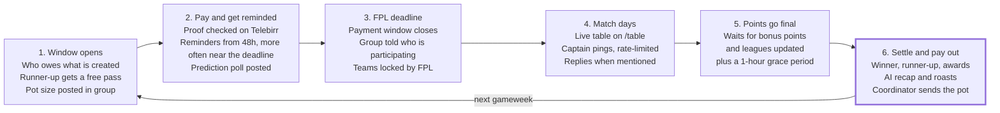
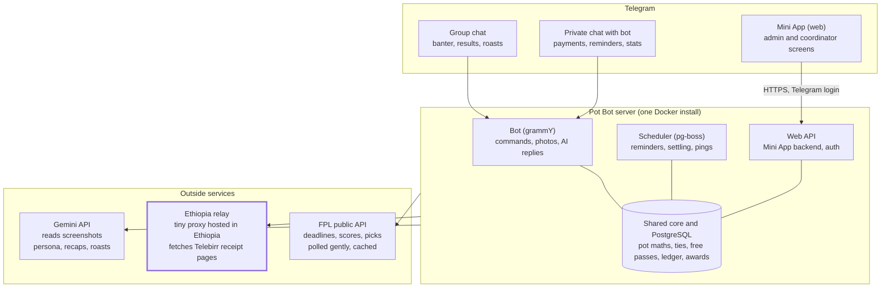

# FPL Pot Bot — Product Spec & Build Plan

Nov 5, 2026 · Gezahegn Gulilat

Requirements and acceptance criteria for building it: see `docs/PRD.md`.

## The idea

A Telegram bot plus a small admin web app that runs a weekly paid FPL mini-league for a friend group: it collects and verifies Telebirr payments, chases late payers, announces the leader and the winner, and roasts everyone along the way. The working name in this doc is **Pot Bot**; rename it freely.

**Today (10 friends, 100 birr each per gameweek):**

1. Gameweek starts; everyone sends 100 birr to the coordinator on Telebirr.
2. Each person posts a screenshot in the Telegram group.
3. Some forget, and the deadline passes with no clear record of who paid.
4. After the gameweek, someone checks FPL by hand to find the winner.
5. Winner takes the whole pot; the runner-up skips paying next gameweek.

**What hurts:** forgotten payments, screenshots nobody can verify, manual winner checks, and no running record of who owes, who won and how much. The fun part, the banter, all depends on someone bothering to start it.

**What Pot Bot changes:** payments are checked against Telebirr's own receipt, reminders go out on their own before the real FPL deadline, results come straight from FPL, and an AI "commentator" that knows the group keeps the chat lively. The coordinator only steps in when something looks wrong.

## Good news: almost all of it can be automatic

The two parts you assumed need manual work, results and payment checks, both have workable automatic paths. The admin web app becomes a fallback and an override, not the main tool.

| Job | How it gets automated | Manual fallback |
| --- | --- | --- |
| Gameweek deadlines | FPL's public API lists every gameweek with its deadline time. The bot schedules reminders from it. | Admin sets the deadline by hand |
| Scores, leader, winner | FPL's public API returns your private league's table, including each manager's points for the current gameweek. No login or key needed. | Admin types scores in the web app |
| "Are the points final?" | FPL's `event-status/` endpoint says when bonus points are added and leagues updated. The bot waits for that before declaring a winner. | Admin presses "Confirm results" |
| Payment proof | Gemini vision reads the screenshot (or the pasted Telebirr SMS) and pulls out the transaction ID, amount and time. | Member types the ID with `/paid DET8FJGUJ4` |
| Payment is real | Every Telebirr transaction has a public receipt page at `transactioninfo.ethiotelecom.et/receipt/<ID>`. The bot fetches it and checks receiver, amount, date and status. | Coordinator approves it in the web app |
| Fake or reused proof | Each transaction ID can be used only once, and its date must fall inside the current payment window. | Coordinator rejects it |

**Two catches to design around:**

- **The FPL API is unofficial.** The Premier League does not document it, so cache responses and poll gently (every 10 to 30 minutes on match days is plenty). Wrap it in one module so a change breaks only one file.
- **Telebirr receipt pages are region-locked.** An open-source verifier warns that verification can fail from servers outside Ethiopia and suggests a small relay hosted inside Ethiopia. Plan for this from day one (see Architecture).

You don't have to write the receipt parser from scratch. Several open-source Ethiopian payment verifiers already handle Telebirr: [verifier-api](https://github.com/Vixen878/verifier-api) (Node, includes a fallback proxy), [tx-verify](https://pypi.org/project/tx-verify/1.0.2/) (Python), and [verification-engine](https://github.com/oneshotefa/verification-engine) (Node: SMS, link, ID or screenshot). Use one as a reference or a dependency.

## League rules: your rules as defaults, all configurable

With 10 players, and last week's winner and runner-up skipping their fee, a normal gameweek pot is 8 × 100 = **800 birr**. Everyone sends their fee to the coordinator, who can't send money to themselves, so if they play too, their own fee is counted automatically. They're never reminded, and if they win, nothing is sent or announced as delivered, because they already hold the pot. Every rule below is a setting in the admin app, so other groups can run their own version.

| Rule | Your default | Other options to offer |
| --- | --- | --- |
| Entry fee | 100 birr per gameweek | Any amount; season-long fee paid once |
| Prize split | Winner takes all | 70/30 split; top 3 split |
| Winner perk | Skips the next gameweek's payment | Off |
| Runner-up perk | Skips the next gameweek's payment | Off; half price; "double or nothing" choice |
| Who can win | Only members marked paid (the runner-up's free pass counts as paid) | Everyone wins, unpaid winners owe the pot |
| Score used | FPL gameweek points after transfer hits | Before hits |
| Tie for 1st | Split the pot equally | Tie-break by fewer hits, then overall rank |
| Tie for 1st or 2nd | Everyone tied skips the next payment | Tie-break as above |
| Late payment | Not eligible to win this gameweek | Pay 120 birr after the deadline; lose free passes |
| Double or blank gameweeks | Treated as normal gameweeks | Double fee, double pot |

**Rules worth adding for fun:**

- **Wooden Spoon:** last place gets a public roast and has to change their Telegram profile picture to one the winner picks for a week. It costs nothing and is more fun than money.
- **Season jackpot:** an optional 10 birr from each gameweek pot goes into a season-end prize for the top overall manager.
- **Streak bonus:** win twice in a row and the bot announces a "dynasty" with a special badge.
- **Captain fail tax:** if your captain scores 2 points or fewer, you are the bot's main roast target that week (fun only, no money).

**Edge cases to handle in code:** a member who never set an FPL team; a mid-season join or leave; a refund when a gameweek is postponed; the coordinator being a player too, since their own payment is just a ledger entry.

## Weekly lifecycle

In a normal week the only human step is sending the pot to the winner; the bot schedules everything else from FPL's deadline and status data.

Closing the payment window at the FPL deadline is a default; the admin can move it (see open questions under Risks).

## Payment flow

A member sends proof in any form they like, the bot verifies it against Telebirr in seconds, and only failures reach the coordinator.

1. **Member sends proof**, either in the group or in a private chat with the bot. It can be a screenshot, the forwarded Telebirr SMS, the receipt link, or `/paid <transaction ID>`.
2. **Bot extracts the transaction ID.** It uses a regex for SMS and links, and Gemini vision for screenshots. If it finds nothing, it asks the member to type the ID.
3. **Bot fetches the receipt** from Telebirr through the Ethiopia relay (see Architecture).
4. **Bot runs the checks:**
   - The status is completed.
   - The receiver's name or number matches the coordinator's Telebirr account saved in settings.
   - The amount is at least the entry fee.
   - The payment date is inside this gameweek's payment window.
   - The transaction ID has never been used before, by anyone.
   - The payer name loosely matches the member (a warning only, since people pay for friends).
5. **All checks pass:** the payment is marked verified and the bot reacts in the group with a short fun line ("Abel paid. The pot grows to 600 birr. Who's next?"). It deletes the screenshot if the admin turned on "keep the chat clean".
6. **Any check fails or the receipt can't be reached:** the payment goes to "Needs review" in the web app with the reason. The coordinator approves or rejects with one tap, and the member is told the result.
7. **Cash or other payments:** the coordinator marks the member paid by hand, with a note.

**Current mode: screenshot checks only.** For now the receipt page in steps 3 and 4 is not fetched. The bot reads the screenshot itself and accepts it only if it is a successful Telebirr screenshot showing a transaction number and receiver, with the receiver matching the name the admin provided and an amount of at least the fee. Telebirr's screenshots show no sender name, and their amount includes Telebirr's own fee (101.00 for a 100 birr payment), so the pot counts the entry fee, not the amount on the screenshot. Their times have no timezone and are read in the league's time zone. Any other image is not considered. To keep AI costs down, a group photo is checked only when the bot is @mentioned in its caption or in a reply to it; every photo sent privately to the bot is checked. A screenshot that can't be read goes to the coordinator by private message with Approve and Reject buttons, and an approved payment is then shown in the group. A screenshot sent privately is announced and shown in the group after the check. One dated after the deadline is rejected for this gameweek and counts toward the next. The receipt check can be turned on later; until then an edited screenshot could pass, which step 3 would otherwise catch.

**Privacy:** keep only the transaction ID, amount, date, status and a match flag. Do not store full receipt pages, phone numbers or screenshots longer than needed. Screenshots in Telegram are already visible to the group, but your database should hold less.

## The fun layer

The best jokes come from real FPL data about real friends, so the AI gets each week's numbers plus a small memory of each member, and writes in a persona the group picks.

**1. A persona with a voice.** The admin picks or writes one: an over-excited Ethiopian football commentator, a savage pundit, a disappointed grandfather. It writes in English, Amharic or a mix, and a "spice level" from 1 to 5 controls how hard it roasts.

**2. A memory of each member.** The bot keeps a short profile per person: nickname, favourite Premier League club, running jokes, best and worst moments. It learns from the season's FPL history and from facts the admin adds ("Dawit says every season is his year"). Members can see their own profile with `/me` and ask to delete it.

**3. Roasts built from real numbers.** All of these come from FPL picks and live data:

- Points left on the bench
- A captain who blanked while the vice-captain scored 15
- A transfer hit that scored less than its cost
- Selling a player the week he scored a hat-trick
- Forgetting to make a transfer before the deadline

**4. Weekly awards** posted with the results, each with a one-line roast:

| Award | Goes to |
| --- | --- |
| Gameweek King | Highest score; takes the pot and skips the next payment |
| Free Pass | Runner-up; skips next payment |
| Wooden Spoon | Lowest score |
| Bench Boss | Most points left on the bench |
| Captain Calamity | Worst captain return |
| Hit Man | Most points spent on transfer hits |
| The Genius | Best differential pick that nobody else owned |

**5. Reminders that get sassier.** Unpaid members are reminded in seven rounds, each both in the group with an @mention and by private message: once 2 days before the deadline (48h), twice with 1 day left (24h, 18h), and four times on deadline day (6h, 3h, 1h, 15m). The tone gets cheekier as the deadline nears: "These 3 still haven't paid. The pot is waiting, gentlemen." Members who have paid hear nothing. A member with no Telegram username is mentioned by a link to their account, and one who hasn't claimed a team is named by team. When the deadline passes, the group gets a message listing who is participating this gameweek.

**6. Match-day pings, rate-limited.** "Kebede's captain just scored. Kebede is now 1st. Everyone else, pray." Allow at most a few per match day so the group isn't spammed.

**7. Prediction polls.** Before each deadline the bot posts a native Telegram poll: "Who wins this gameweek?" It tracks who predicts best across the season, for bragging rights only.

**8. Admin tools for fun.** `/roast @name` makes the bot write a roast in its persona. The admin can also write a rough joke and the bot polishes it, or schedule a message ("post this meme Saturday at 14:00").

**9. Shareable cards.** The leaderboard, the winner and the awards are rendered as images people can repost elsewhere. This is free advertising if you open-source it.

**10. Hall of Fame and Shame.** Season totals per person: pots won, money paid in, net profit or loss ("Biniam is down 700 birr this season"), longest losing streak.

**Guardrails for the AI.** Roast FPL decisions, never people's religion, ethnicity, family, looks or money problems. Members can type `/nofun` to stop being roasted. The bot replies only when mentioned or replied to, and has a daily message limit so it never floods the chat.

## Bot commands

The group chat is for showing off and roasting; private chat is for payments and personal stats. Two Telegram rules shape this:

- **A bot can't message someone privately until that person presses Start.** Onboarding must get every member to open the bot once, using a deep link the bot posts in the group.
- **By default a bot in a group sees only commands and messages aimed at it.** To read screenshots and banter, turn off privacy mode in BotFather (`/setprivacy`) or make the bot a group admin.

| Command | Where | What it does |
| --- | --- | --- |
| `/start` | Private | Links your Telegram account to your FPL team ID |
| `/setup` | Group, owner only | Links the group to the FPL classic league and runs the import |
| `/paid <ID>` | Both | Submits a payment by transaction ID (a screenshot or SMS also works) |
| `/status` | Both | This gameweek: who paid, the pot size, time until the deadline |
| `/table` | Group | Live gameweek table plus the overall table |
| `/me` | Private | Your season: winnings, money paid, net, streaks, what the bot "knows" about you |
| `/owe` | Private | Whether you owe anything, with the coordinator's Telebirr number |
| `/awards` | Group | Last gameweek's awards again |
| `/predict` | Group | Opens the "who wins this gameweek?" poll |
| `/roast @name` | Group, admin only | AI roast of a member, in persona |
| `/say <text>` | Private, admin only | Bot posts your text to the group, optionally rewritten in persona |
| `/nofun` | Private | Opt out of roasts (you can still play) |
| `/help` | Both | List of commands |

Any message that mentions the bot or replies to it gets an in-character AI answer, within the daily limit.

## Admin web app

Build it as a **Telegram Mini App**: a web page that opens inside Telegram from a button on the bot. Telegram tells the page who the user is, so there are no passwords, and it still works as a normal website on a laptop.

**Roles:** the **owner** sets up the league, the **coordinator** handles money (can be the same person), and **members** get a read-only view of the table, the ledger and their own stats.

| Screen | What the coordinator does there |
| --- | --- |
| Dashboard | This gameweek at a glance: pot, paid and unpaid members, deadline countdown, current leader |
| Payments | Review queue for failed checks, with the reason; approve, reject or mark as cash |
| Results | See the auto-pulled scores; override a score, set the winner by hand, or confirm results early |
| Ledger | Every birr in and out per member and per gameweek; record pot payouts to winners; export CSV |
| Members | Link Telegram users to FPL team IDs; mark someone as left or paused; edit profile facts for the AI |
| Rules | Every setting from the League rules section |
| Bot personality | Persona, language mix, spice level, daily message limit, quiet hours |
| Scheduled posts | Write or upload a message or meme and pick when it goes out |
| Audit log | Who changed what and when; every manual override is logged |

**Payout step:** the bot can't send money. After results, the coordinator sends the pot by Telebirr and taps "Paid out" (or pastes the transaction ID so the bot verifies the payout too). The bot then posts "Pot delivered" in the group, which builds trust.

## Architecture and tech stack

One TypeScript codebase in one Docker install runs the bot, the scheduler and the Mini App backend over a single PostgreSQL database. The only unusual piece is a small relay inside Ethiopia for Telebirr receipts.

| Part | Pick | Why |
| --- | --- | --- |
| Language | TypeScript on Node.js | One language for bot, web and shared rules; Claude Code handles it well |
| Telegram framework | grammY | Modern, typed, good docs, works with webhooks |
| Database | PostgreSQL with Prisma | Relational fits the ledger; Prisma migrations are easy to vibe code |
| Scheduled jobs | pg-boss | Job queue stored in Postgres, so no Redis to run |
| Mini App | React with Vite | Small, fast; opens inside Telegram |
| AI | Gemini API | Vision for screenshots and text for persona; optional |
| Hosting | Any small VPS, plus the relay in Ethiopia | Or host everything in Ethiopia and skip the relay |

The relay can be a single small script on cheap Ethiopian hosting that accepts a transaction ID plus a shared secret and returns the receipt page; verifier-api ships an example of this pattern.

## Data model

Nine tables cover everything. All league data hangs off `leagues`, so one install can serve many groups.

| Table | Key fields | Notes |
| --- | --- | --- |
| `leagues` | id, name, telegram_chat_id, fpl_league_id, first_pot_gw, coordinator_telebirr_name, coordinator_telebirr_phone, rules (JSON), persona (JSON), timezone | One row per friend group |
| `users` | id, telegram_id, display_name, language | A person can join several leagues |
| `members` | league_id, user_id, fpl_entry_id, fpl_team_name, fpl_manager_name, role (owner, coordinator, member), status (active, paused, left), roast_opt_out | Joins users to leagues |
| `gameweeks` | league_id, fpl_event_id, deadline_at, payment_closes_at, status (open, locked, live, finished, settled), pot_amount | Status moves forward only |
| `obligations` | gameweek_id, member_id, amount_due, reason (entry, free_pass, late_fee), status (due, paid, waived) | Who owes what each week |
| `payments` | obligation_id, txn_id (unique), amount, paid_at, payer_name, receiver_match, method (screenshot, sms, id, manual), verify_status, verify_reason, reviewed_by | `txn_id` unique across all leagues blocks reused proofs |
| `scores` | gameweek_id, member_id, points, transfer_cost, bench_points, captain_points, rank_in_gw, source (fpl, manual) | Snapshot when the gameweek settles |
| `results` | gameweek_id, winner_member_ids, runner_up_member_ids, payout_amount, payout_txn_id, paid_out_at | Ties are arrays |
| `member_facts` | member_id, fact, source (admin, ai, fpl), created_at | The AI's memory; members can view and delete |

Also add a `messages_log` table (what the bot posted, for rate limits and so the AI avoids repeating jokes) and an `audit_log` table for manual overrides.

## Making it open source

Design it for many groups from the first commit; adding that later means rewriting the database. A few choices make it easy for other groups to adopt:

- **Multi-league from day one.** One bot can sit in many groups, and each group gets its own league, rules and persona. Setup is `/setup` in a new group followed by a short wizard in the Mini App.
- **Two ways to run it.** Self-hosting is `docker compose up` with a `.env` file (bot token, database URL, optional AI key, optional Ethiopia relay URL). You can also run a hosted instance for groups that don't want to self-host.
- **AI is optional.** Without an AI key the bot falls back to template messages, so anyone can try it for free. With a key, use a small, cheap model for routine lines and a bigger one only for the weekly recap.
- **Pluggable payments.** Define a `PaymentVerifier` interface and ship Telebirr first. Others can add CBE Birr, M-Pesa or plain "cash, coordinator confirms", which also lets groups outside Ethiopia use it.
- **Pluggable fantasy sources.** Ship FPL first behind a `FantasyProvider` interface, so contributors can add other fantasy games later.
- **Translations and personas as files.** Put messages in `locales/en.json` and `locales/am.json`, and personas in `personas/*.md`. These are the easiest things for new contributors to add.
- **Licence.** MIT is the simplest. AGPL-3.0 is the choice if you want anyone who runs a modified hosted version to share their changes.
- **Good README.** Include a 60-second demo GIF, the setup steps, and a clear note that the bot never holds money; it only tracks and verifies.

## Risks and safeguards

The biggest risks are a wrong winner and a broken payment check, so both have a human override and a log.

| Risk | Safeguard |
| --- | --- |
| Telebirr blocks receipt requests from your server | Host the bot in Ethiopia, or keep a tiny relay there; if both fail, send payments to manual review instead of rejecting them |
| Telebirr changes its receipt page layout | Keep the parser in one file with a saved sample page and a test; send failures to manual review |
| FPL API changes or goes down | Cache the last good data; the admin can enter scores by hand; settle only after `event-status` says leagues are updated |
| A fake or edited screenshot | The screenshot only supplies the ID; the truth comes from Telebirr's own receipt page |
| One payment used twice | `txn_id` is unique across the whole database |
| A winner declared before bonus points are added | Wait for FPL's final status, then a 1-hour grace period, then announce |
| The AI says something hurtful | Topic guardrails in the system prompt, a spice level, `/nofun`, and the admin can delete or disable AI replies |
| AI costs grow | Daily message caps per league, a small model for routine lines, and template fallback when the cap is hit |
| Bot token or database leaks | Secrets only in `.env`; never commit it; store as little personal data as possible |
| Money pools and local law | The bot never holds or moves money; it only records what friends send each other. If it grows into a public product, get local legal advice first (this isn't legal advice) |

**Open questions to settle with your group:**

- When does the payment window close: at the FPL deadline, or some hours after the gameweek starts?
- Is the score before or after transfer hits?
- What happens to a non-payer who would have won?

## Build plan for Claude Code

Build in phases, and use each one with your group for a gameweek before starting the next. Phase 1 alone already removes the manual winner check. The ready-to-paste prompts are in `KICKOFF_PROMPT.md`; the project rules Claude Code follows are in `CLAUDE.md`.

- [ ] **Phase 0: skeleton.** pnpm monorepo (`apps/bot`, `apps/web`, `packages/core`, `packages/db`, `packages/fpl`, `packages/payments`, `packages/ai`), docker-compose with Postgres, `.env.example`, pg-boss, Prisma schema from the Data model section, `/start` replies.
- [ ] **Phase 1: FPL import, results and leaderboard.** Typed FPL client with caching and retry; `/setup` with league import and season backfill; deep-link onboarding where members pick their team; `/table`; settle job after `event-status` plus 1-hour grace; unit tests for winner, tie and runner-up logic.
- [ ] **Phase 2: payments by transaction ID and reminders.** `PaymentVerifier` + Telebirr implementation (direct or via `RELAY_URL`), receipt parser with an HTML fixture, `/paid <id>`, obligations with free passes, unique `txn_id`, needs-review with coordinator buttons, reminders at 48h, 24h, 18h, 6h, 3h, 1h and 15m (group and private), and a participants post at the deadline.
- [ ] **Phase 3: admin Mini App.** `initData` validation; Dashboard, Payments review, Results override, Ledger with CSV, Members, Rules, Audit log; role checks.
- [ ] **Phase 4: screenshots and SMS.** Regex for SMS and links, Anthropic vision for images returning `{txn_id, amount, date}`, fed into `/paid`; delete images after.
- [ ] **Phase 5: AI personality and awards.** Personas from `personas/*.md`, spice level, English/Amharic mix, guardrails, weekly awards from FPL data, recap, sassy reminders, `/roast`, mention replies, match-day pings, daily cap and template fallback, `member_facts`, `/me`, `/nofun`.
- [ ] **Phase 6: open-source polish.** Per-league settings everywhere, locales, image cards, one-command Docker setup, README, CONTRIBUTING.md, LICENSE.

**Tip for vibe coding:** ask Claude Code to write the tests for a phase before the code, and keep one real receipt page and one real FPL response saved as test fixtures. That way it can check its own work without touching live services.

## Sources

- [FPL API endpoints reference for 2026/27](https://dev.to/odeeb/fpl-api-endpoints-complete-reference-for-202627-5g3d): keyless public API, league standings, `event-status`
- [Fantasy Premier League API spec notes (Jentic)](https://jentic.com/apis/fantasy.premierleague.com/fantasy-premierleague.md): unofficial API, cache and poll sparingly
- [verifier-api](https://github.com/Vixen878/verifier-api): Telebirr receipt URL, extracted fields, region restriction and relay workaround
- [tx-verify](https://pypi.org/project/tx-verify/1.0.2/): Python verifier for Telebirr and other Ethiopian providers
- [verification-engine](https://github.com/oneshotefa/verification-engine): Node verifier by SMS, link, ID or screenshot
